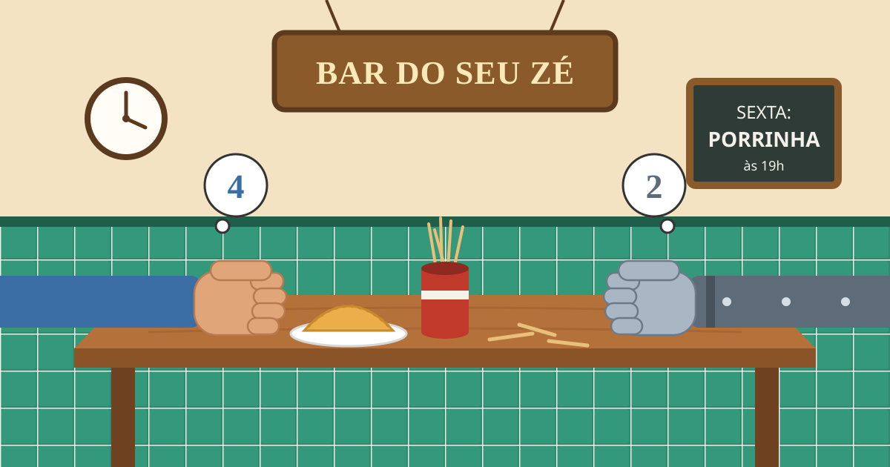

# Porrinha em C# – Bar do Seu Zé



Neste repositório você vai construir, passo a passo, o **jogo da porrinha** em C#, aplicando os conteúdos de uma disciplina introdutória de algoritmos e lógica de programação. O jogo cresce bloco a bloco: cada bloco apresenta um conceito novo e usa esse conceito para dar mais um passo no jogo.

---

## A história

No **Bar do Seu Zé**, na esquina da sua rua, toda sexta-feira tem campeonato de porrinha. Os palitos saem do paliteiro do balcão, cada jogador pega três e as mãos fechadas vão para cima da mesa, entre um pastel e outro. O campeão invicto é o próprio Seu Zé, que nunca perde um palpite.

Cansado de ser derrotado, você teve uma ideia: treinar em casa contra um adversário que nunca se cansa. Só que esse adversário ainda não existe. **Você vai programá-lo.**

---

## O que você vai aprender

| Conteúdo | Onde aparece |
| --- | --- |
| Tipos de dados, constantes, variáveis e identificadores | Bloco 01 |
| Comandos de entrada e saída | Bloco 01 |
| Operador de atribuição, operadores aritméticos e estrutura sequencial | Bloco 02 |
| Operadores relacionais e lógicos, tabela verdade | Bloco 03 |
| Estruturas de decisão simples, composta, encadeada e de múltipla escolha | Bloco 03 |
| Estruturas de repetição `while`, `do-while` e `for` | Bloco 04 |
| Vetores e matrizes | Bloco 05 |
| Funções, parâmetros e retorno | Bloco 06 |
| Procedimentos, passagem de parâmetros por valor e por referência | Bloco 07 |
| Uso de uma biblioteca externa e manutenção de código | Bloco 08 |

---

## Regras da porrinha

A versão deste tutorial é para **dois jogadores: você contra o Computador**.

1. Cada jogador começa com **3 palitos**.
2. A cada rodada, cada jogador esconde na mão fechada **de 0 até todos os palitos que ainda tem**.
3. Cada jogador dá um **palpite do total** de palitos que há nas duas mãos juntas.
4. O segundo a chutar **não pode repetir** o palpite do primeiro.
5. Quem chuta primeiro **alterna** a cada rodada: na rodada 1 é você, na rodada 2 é o Computador, e assim por diante.
6. As mãos são abertas. Quem acertou o total **descarta um palito**. Se ninguém acertou, ninguém descarta.
7. **Vence quem ficar sem palitos primeiro.**

### Uma rodada de exemplo

Você e o Computador estão com 3 palitos cada. É a rodada 1, então você chuta primeiro.

- Você esconde **2** palitos na mão. O Computador esconde **1** (você não sabe disso).
- Você pensa: "eu tenho 2; se ele tiver uns 2, dá 4". Seu palpite é **4**.
- O Computador não pode repetir o 4 e chuta **3**.
- Mãos abertas: 2 + 1 = **3**. O Computador acertou e descarta um palito.
- Placar: você com 3, o Computador com 2. Na rodada 2, o Computador chuta primeiro.

---

## Como vai ficar

Ao final do bloco 07, o seu jogo vai funcionar assim:

```text
==========================================
        BEM-VINDO AO BAR DO SEU ZÉ
==========================================

Qual é o seu nome? Ana

---------------- MENU ----------------
1 - Jogar uma partida
2 - Ver as regras
3 - Sair
Escolha uma opção: 1

============== RODADA 1 ==============
Ana: | | |
Computador: | | |

Quantos palitos você vai esconder na mão (0 a 3)? 2
Seu palpite para o total (0 a 6): 4
O Computador chutou 3.

Mãos abertas!
Ana escondeu 2.
Computador escondeu 1.
Total na mesa: 3
Seu Zé: "Olha a mesa cheia de palito!"
Computador acertou! Descarta um palito.
```

E no bloco 08 o jogo ganha um visual novo, com título em letras grandes, placar em tabela e cores, usando a biblioteca **Spectre.Console**.

---

## Antes de começar

### O que instalar

- **[.NET 10 SDK](https://dotnet.microsoft.com/download)** ou mais recente.
- Um editor de código. Sugestões: **Visual Studio Code** com a extensão **C# Dev Kit**, ou o **Visual Studio**.
- **Git**, para clonar o repositório e salvar o seu progresso.

Para conferir se o .NET está instalado, abra um terminal e digite:

```bash
dotnet --version
```

### Pegando o projeto

Faça um *fork* deste repositório na sua conta do GitHub e depois clone o seu *fork*:

```bash
git clone https://github.com/SEU-USUARIO/porrinha-csharp.git
cd porrinha-csharp
```

### Rodando o jogo

Todo o jogo fica em um único arquivo: `Porrinha/Program.cs`. Com o .NET 10, você roda o arquivo diretamente:

```bash
cd Porrinha
dotnet run Program.cs
```

**Usando o Visual Studio ou uma versão anterior do .NET?** Crie um projeto do tipo *Console App* e substitua o conteúdo do `Program.cs` do projeto pelo conteúdo do `Porrinha/Program.cs`. A cada bloco, continue trabalhando no `Program.cs` do seu projeto.

---

## Como usar este tutorial

Siga os blocos **em ordem**. Cada um parte do código que você terminou no bloco anterior, sempre no mesmo arquivo `Program.cs`.

Do bloco 01 ao 07, cada bloco tem o mesmo formato:

1. **Objetivo**: o que você vai aprender e o que o jogo ganha.
2. **Conceitos**: a explicação, com exemplos curtos fora do jogo.
3. **No jogo**: o código do jogo com **lacunas** marcadas com `// TODO`. Você completa cada lacuna no seu `Program.cs`.
4. **Dicas**: uma ajuda para cada lacuna, caso você trave.
5. **Sua vez**: exercícios para ir além.
6. **Checkpoint**: o que o programa precisa fazer ao final do bloco.

O bloco 08 é diferente: ele é **totalmente guiado**, porque apresenta uma biblioteca nova. Cada alteração vem explicada em detalhe.

Algumas recomendações:

- **Digite o código em vez de copiar e colar.** Digitar ajuda a entender e a memorizar.
- **Só avance quando o checkpoint funcionar.**
- **Faça um *commit* ao final de cada bloco**, assim você guarda cada etapa e pode voltar se algo der errado:

```bash
git add .
git commit -m "Bloco 01 concluído"
git push
```

---

## Mapa dos blocos

| Bloco | Título | Conceitos |
| --- | --- | --- |
| [01](blocos/01-variaveis.md) | Bem-vindo ao bar | Tipos, constantes, variáveis, entrada e saída |
| [02](blocos/02-sequencial.md) | A primeira rodada | Atribuição, operadores aritméticos, sorteio, estrutura sequencial |
| [03](blocos/03-decisao.md) | Quem acertou? | Operadores relacionais e lógicos, `if`, `else if`, `else`, `switch` |
| [04](blocos/04-repeticao.md) | A partida completa | `while`, `do-while`, `for`, validação de entrada |
| [05](blocos/05-vetores.md) | Organizando a mesa | Vetores e matrizes |
| [06](blocos/06-funcoes.md) | Pensando como o Seu Zé | Funções, parâmetros e retorno |
| [07](blocos/07-procedimentos.md) | O jogo pronto | Procedimentos, passagem por valor e por referência, menu |
| [08](blocos/08-spectre.md) | A cara do bar | Biblioteca Spectre.Console |

---

## Regras do código

Este tutorial trabalha com **programação estruturada**. Por isso:

- **Não usamos classes nem orientação a objetos.** Nada de `class`, `struct` ou `record`.
- Todo o código fica em *top-level statements*, direto no `Program.cs`, sem `Main`.
- Funções e procedimentos ficam no fim do arquivo.
- Os nomes de variáveis são em português e descritivos (`palitosJogador`, e não `pj`).
- Use apenas os recursos vistos até o bloco em que você está.

---

## Para professores

Este material foi pensado para ser reutilizado. Fique à vontade para fazer um *fork* e adaptar à sua turma.

| Bloco | Pré-requisito | Tempo estimado |
| --- | --- | --- |
| 01 | Nenhum | 1 h |
| 02 | Bloco 01 | 1 h |
| 03 | Bloco 02 | 1 h 30 |
| 04 | Bloco 03 | 2 h |
| 05 | Bloco 04 | 1 h 30 |
| 06 | Bloco 05 | 1 h 30 |
| 07 | Bloco 06 | 2 h |
| 08 | Bloco 07 | 1 h 30 |

Algumas observações:

- Os blocos acompanham a ordem típica de um curso de algoritmos. Cada bloco pode ser aplicado logo depois da aula do conteúdo correspondente.
- Os blocos 05, 06 e 07 são de **refatoração**: o jogo já funciona e o aluno muda a organização do código sem mudar o comportamento. É uma boa oportunidade para trabalhar manutenção de software.
- Os blocos 05 e 06 têm desafios opcionais de **matrizes** e de **recursividade**.
- As soluções de referência **não estão neste repositório**, de propósito, para não entregar as respostas aos alunos.

---

## Licença

- O **código** deste repositório está sob a [licença MIT](LICENSE).
- Os **textos e a ilustração** estão sob a licença [Creative Commons Atribuição-CompartilhaIgual 4.0 (CC BY-SA 4.0)](LICENSE-CONTEUDO.md).

Você pode usar, adaptar e redistribuir este material, desde que cite a fonte e mantenha a mesma licença nas adaptações dos textos.
